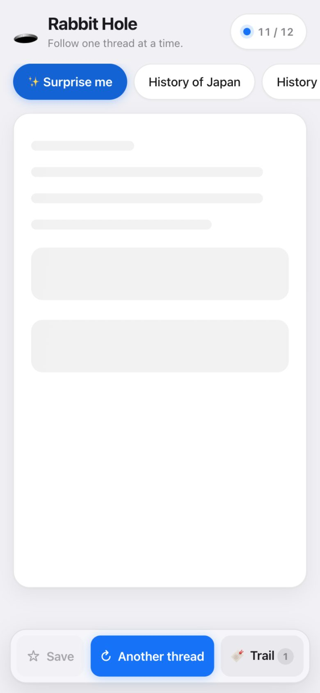
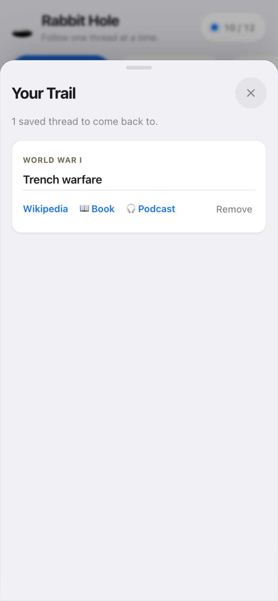

# 🕳️ Rabbit Hole

A small, calm web app for following **one curiosity thread at a time** — an antidote to the endless social feed.

Every thread is a single card: a **Wikipedia article**, a **book** to go deeper, and a **podcast** to listen to on the way. Tap through a few; when something hooks you, save it to your **Trail** to come back to later.





## Ideas it's built on

- **One card at a time.** No infinite scroll, no feed, no autoplay into the void.
- **A daily limit.** Twelve threads a day (`DAILY_LIMIT` in `app.js`). Reloading doesn't cost a thread. Asking for "one more" grants exactly one extra — and then it stops.
- **A handedness you control.** Pick a topic; the app finds a thread worth pulling.
- **Save what matters.** The Trail keeps the threads worth returning to.
- **Built for the commute.** Mobile-first, big tap targets, readable in the car or on the train.

## Topics

History of Japan · History of China · World War I · World War II · Wars & conflict · History of Brazil · Space · Physics · Curiosity itself

## Data sources

Everything comes from free, public, key-less APIs — no backend, no accounts, no tracking:

| What | Source |
| --- | --- |
| Article | [Wikipedia REST API](https://en.wikipedia.org/api/rest_v1/) |
| Book | [Open Library](https://openlibrary.org/developers/api) (English editions) |
| Podcast | [iTunes Search API](https://performance-partners.apple.com/search-api) (US store) |

These endpoints send permissive CORS headers, so the app is a pure static site — it can be served from anywhere, including GitHub Pages.

## Run it

```sh
node serve.js
# → http://localhost:8123
```

`serve.js` is a tiny static file server (`node serve.js [port] [dir]`). A local server is needed because the app uses ES modules and `fetch`, which browsers restrict on `file://`.

No build step, no dependencies. `index.html` + `styles.css` + `app.js` is the whole app.

## Design

Apple-leaning and restrained: the SF system font stack, iOS label colors, hairline separators, soft layered shadows, a single blue accent, a translucent action bar, and a full dark mode via `prefers-color-scheme`. Motion is gentle and respects `prefers-reduced-motion`.

## Why

Trying to spend less time on social media by replacing it with curiosity — the history, wars, space, physics, and the occasional rabbit hole, one thread at a time.
